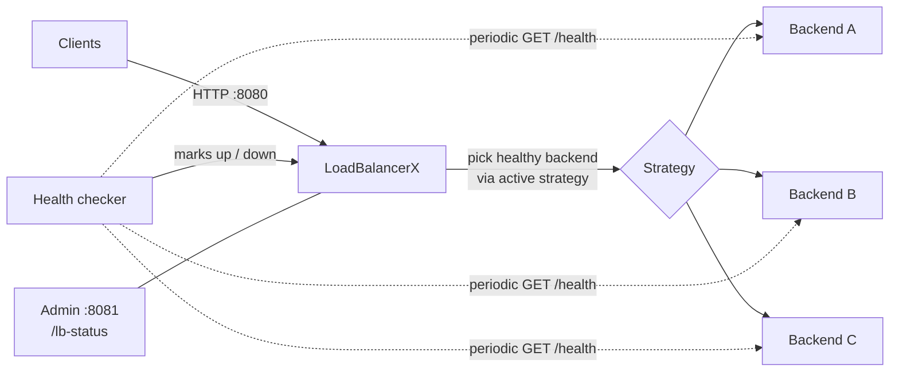
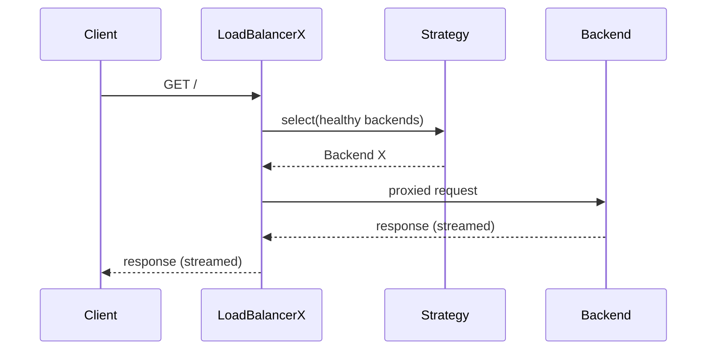
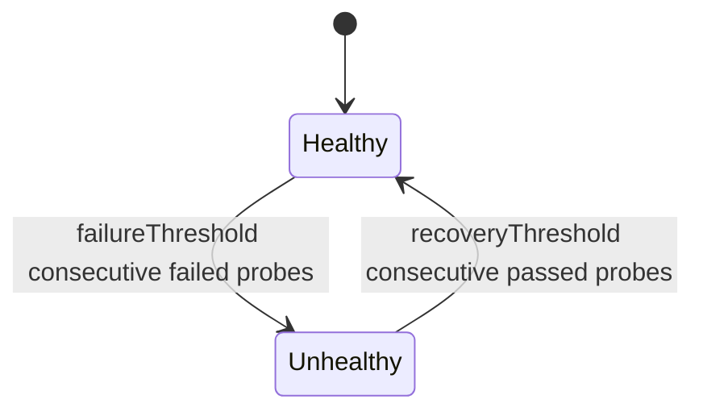

# LoadBalancerX

> A small, configurable HTTP load balancer in Node.js with three routing strategies and active health checking.


LoadBalancerX sits in front of a pool of backend servers and spreads incoming requests across them using **round robin**, **least connections**, or **consistent hashing**. It runs **active health checks** so unhealthy backends are pulled out of rotation automatically and added back once they recover.

> **Scope:** this is a portfolio project built to demonstrate the core load-balancing algorithms and failure handling. It is not intended to be a production load balancer.

---

## Table of Contents

- [Features](#features)
- [How It Works](#how-it-works)
- [Quickstart](#quickstart)
- [Routing Strategies](#routing-strategies)
- [Health Checks](#health-checks)
- [Configuration](#configuration)
- [Admin Endpoint](#admin-endpoint)
- [Tooling: Mock Backend and Load Generator](#tooling-mock-backend-and-load-generator)
- [Testing](#testing)
- [Design Notes](#design-notes)
- [Limitations](#limitations)
- [Documentation](#documentation)

---

## Features

- **Three pluggable strategies:** round robin, least connections, consistent hashing (with virtual nodes)
- **Active health checks:** periodic probes with separate failure and recovery thresholds
- **Streaming reverse proxy:** requests are proxied to the chosen backend and responses are streamed back
- **Separate admin port:** live state at `/lb-status`, kept off the proxy port
- **Built-in test tooling:** configurable mock backends (latency, failure rate, going unhealthy) and a load generator
- **Unit and integration tests:** strategy logic, health-check thresholds, and end-to-end routing against real mock backends

## How It Works



For each request, the balancer:

1. Asks the active strategy to choose from the **currently healthy** backends.
2. Proxies the request to that backend and streams the response back to the client.
3. Meanwhile, the health checker keeps probing every backend and updates the healthy set.



## Quickstart

**Requirements:** Node.js 20+

```bash
npm install
```

Open four terminals (or background the first three).

**1. Start three mock backends** (the third is deliberately slow):

```bash
npm run mock-backend -- --port=9001 --latency-ms=10
npm run mock-backend -- --port=9002 --latency-ms=10
npm run mock-backend -- --port=9003 --latency-ms=200
```

**2. Start the load balancer** (reads `config.json` by default):

```bash
npm run lb
```

**3. Send traffic and watch the distribution:**

```bash
npm run loadgen -- --url=http://localhost:8080/ --requests=300
```

**4. Check live state at any time:**

```bash
curl http://localhost:8081/lb-status
```

## Routing Strategies

Set the `strategy` field in `config.json`, or point the balancer at another file:

```bash
npm run lb -- --config=other.json
```

Restart the balancer after changing the strategy.

| Strategy | Config value | Best for | Behaviour |
|----------|--------------|----------|-----------|
| Round robin | `round-robin` | Homogeneous backends, similar request cost | Even split across all healthy backends |
| Least connections | `least-connections` | Uneven latency or request cost | Prefers the backend with the fewest in-flight requests |
| Consistent hashing | `consistent-hashing` | Session stickiness, cache affinity | Same key always maps to the same backend while the pool is stable |

### Round robin

Cycles through healthy backends in order. Simple and predictable.

### Least connections

Tracks in-flight requests per backend and routes to the least busy one. With the slow backend from the quickstart (200 ms vs 10 ms), it receives **far fewer** requests than the two fast ones, because its connections stay open longer.

### Consistent hashing

Routes by a key, which is either the **client IP** or the value of a **request header** (set `hashKeySource` to `header`, default header is `x-session-key`). Backends are placed on a hash ring with multiple **virtual nodes** each (default 100) for an even spread. When a backend is added or removed, only the keys that mapped to it move; everything else stays put.

Try it with 10 distinct session keys:

```bash
npm run loadgen -- --url=http://localhost:8080/ --requests=300 --session-keys=10
```

Each key should consistently land on the same backend.

## Health Checks

The balancer probes every backend on an interval and applies **consecutive-result thresholds**, so a single blip doesn't cause flapping.



- A backend is marked **down** after `failureThreshold` consecutive failed probes, i.e. within about `failureThreshold × intervalMs`.
- It is marked **up** again after `recoveryThreshold` consecutive successful probes, i.e. within about `recoveryThreshold × intervalMs`.
- Unhealthy backends receive no traffic until they recover.

**Try it.** Start a backend that turns unhealthy right away:

```bash
npm run mock-backend -- --port=9002 --unhealthy-after-requests=0
```

Send a request through the balancer, then poll `/lb-status`. Within `failureThreshold × intervalMs` the backend flips to `healthy: false` and stops receiving traffic. Restart it and it returns to rotation within `recoveryThreshold × intervalMs`.

## Configuration

All settings live in `config.json`:

```jsonc
{
  "listenPort": 8080,           // proxy port
  "adminPort": 8081,            // /lb-status port (kept separate)
  "strategy": "round-robin",    // round-robin | least-connections | consistent-hashing
  "backends": ["localhost:9001", "localhost:9002", "localhost:9003"],
  "requestTimeoutMs": 30000,    // proxied request timeout
  "healthCheck": {
    "path": "/health",
    "intervalMs": 2000,
    "timeoutMs": 1000,          // separate from requestTimeoutMs on purpose
    "failureThreshold": 3,      // consecutive fails before marking down
    "recoveryThreshold": 2      // consecutive passes before marking up
  },
  "consistentHashing": {
    "virtualNodes": 100,
    "hashKeySource": "client-ip", // or "header"
    "headerName": "x-session-key"
  }
}
```

| Key | Default | Description |
|-----|---------|-------------|
| `listenPort` | `8080` | Port clients send traffic to |
| `adminPort` | `8081` | Port serving `/lb-status` |
| `strategy` | `round-robin` | Routing strategy (see above) |
| `backends` | n/a | List of `host:port` backends |
| `requestTimeoutMs` | `30000` | Timeout for proxied requests |
| `healthCheck.path` | `/health` | Endpoint probed on each backend |
| `healthCheck.intervalMs` | `2000` | Time between probes |
| `healthCheck.timeoutMs` | `1000` | Per-probe timeout |
| `healthCheck.failureThreshold` | `3` | Consecutive failures before marking down |
| `healthCheck.recoveryThreshold` | `2` | Consecutive passes before marking up |
| `consistentHashing.virtualNodes` | `100` | Virtual nodes per backend on the ring |
| `consistentHashing.hashKeySource` | `client-ip` | `client-ip` or `header` |
| `consistentHashing.headerName` | `x-session-key` | Header used when `hashKeySource` is `header` |

## Admin Endpoint

The admin server runs on its own port so operational state is never exposed on the proxy port.

```bash
curl http://localhost:8081/lb-status
```

Use it to see the active strategy and each backend's health while you test failure scenarios.

## Tooling: Mock Backend and Load Generator

### Mock backend

```bash
npm run mock-backend -- --port=9001 --latency-ms=10
```

| Flag | Meaning |
|------|---------|
| `--port` | Port to listen on |
| `--latency-ms` | Fixed delay before responding |
| `--fail-rate` | Probability (0 to 1) of returning a 500 |
| `--unhealthy-after-requests` | Flip `/health` to unhealthy after N requests |

### Load generator

```bash
npm run loadgen -- --url=http://localhost:8080/ --requests=300
```

| Flag | Meaning |
|------|---------|
| `--url` | Target URL (the balancer's proxy port) |
| `--requests` | Total number of requests to send |
| `--session-keys` | Number of distinct session keys to rotate through (for consistent hashing) |

## Testing

```bash
npm test
```

- **Unit tests:** each strategy's selection logic and the health-check thresholds.
- **Integration tests:** spin up real mock backends behind the balancer and assert routing behaviour end to end.

## Design Notes

- **Health-check timeout is separate from request timeout.** A probe should fail fast (`1000 ms`) even though real requests may legitimately take much longer (`30000 ms`).
- **Asymmetric thresholds.** Failing takes 3 consecutive misses, recovering takes 2 passes, which avoids flapping while still bringing healthy backends back quickly.
- **Admin on a separate port.** Keeps status and operational data away from public traffic.
- **Virtual nodes in the hash ring.** Smooths out key distribution and limits how many keys move when the pool changes.

## Limitations

This is a learning and demonstration project, so some production concerns are out of scope:

- Single balancer instance (no HA or failover for the balancer itself)
- No TLS termination
- Strategy changes require a restart
- No authentication on the admin endpoint

## Documentation

- [SETUP.md](SETUP.md): install, configure, run, and deploy
- [ARCHITECTURE.md](ARCHITECTURE.md): how the pieces fit together, with diagrams

---

Built by Naman Bharsakale.